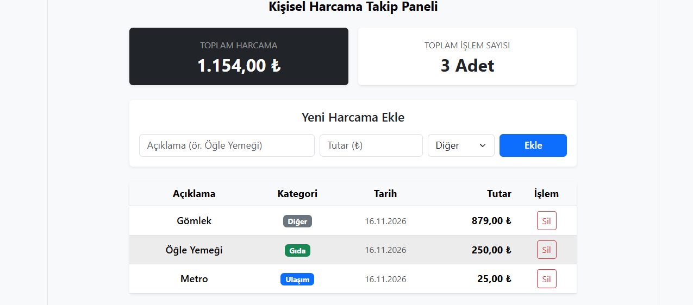

# Kişisel Harcama Takip Paneli

Kullanıcıların günlük harcamalarını kategorilere göre kaydedebildiği, toplam harcama tutarını anlık olarak takip edebildiği ve verilerini tarayıcı hafızasında (`LocalStorage`) saklayabilen modern web uygulamasıdır.

## Ekran Görüntüsü



## Kullanılan Teknolojiler

- **React (Vite):** Bileşen tabanlı kullanıcı arayüzü geliştirme
- **Bootstrap 5:** Duyarlı (responsive) tasarım, kart yapısı, tablo ve kategori rozetleri
- **Web Storage API (LocalStorage):** Sayfa yenilendiğinde verilerin korunması

## Kurulum ve Çalıştırma

Projeyi yerel ortamınızda çalıştırmak için aşağıdaki adımları izleyin:

1. Depoyu klonlayın:
   ```bash
   git clone <GITHUB_REPO_LINKINIZ>
   cd harcama-takip